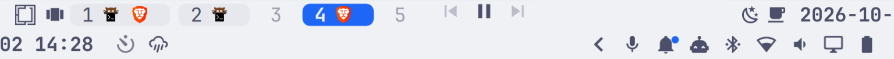

# omarchy-bar-icons

Real SVG icons for the [Omarchy](https://omarchy.org/) bar. Every widget that
draws a Nerd Font glyph draws a Material Design icon instead, as tall as the
bar allows (70% of its thickness) and tinted with exactly the colour the glyph
had, so themes, the transparent bar and alert colours keep working.



Nothing in Omarchy or in a plugin's checkout is edited. Each widget is rebuilt
next to its original as a clone, the way `omarchy plugin clone` makes one, with
a small patch applied; the clone takes the original's place on the bar.

## Use

```console
$ bin/omarchy-bar-icons omarchy.audio omarchy.network crmne.mpris   # install
$ bin/omarchy-bar-icons check omarchy.audio omarchy.network crmne.mpris
```

Each argument is a bar widget's plugin id:

- **An id with a patch in `patches/`** (built-in or third-party): the widget is
  rebuilt as `josemiguelo.<last part of the id>` from its current source,
  Omarchy's copy for a built-in, the tracked files of its git checkout in
  `~/.config/omarchy/plugins/<id>` for a third-party plugin. The rebuild keeps
  `clonedFrom: <id>`, so the shell routes the original's IPC targets and
  services to it; enabling it moves it into the original's place on the bar,
  settings included, disables the original, and moves the bar's centre anchor
  to it when the original held it.
- **An id in `plugins/`**: one of this repo's own widgets, installed as is.

Every installed widget gets `shared/` at its root: `BarSvgIcon.qml`,
`glyphs.js` and the icons.

`check` builds every widget in a temporary folder and compares it with the
installed one. An Omarchy update, an `omarchy plugin update` or a change here
that alters a widget makes it fail; install rebuilds it from the new source.
When a patch no longer applies, install fails and disables that rebuild, which
puts the original widget back on the bar.

Requires an Omarchy with the Quickshell shell (`omarchy-shell`), `jq`, `git`
and `patch`.

## Widgets

| Id | Patch |
|---|---|
| `omarchy.agents`, `omarchy.audio`, `omarchy.bluetooth`, `omarchy.monitor`, `omarchy.network`, `omarchy.power`, `omarchy.system-update`, `omarchy.weather` | the icon button draws `BarSvgIcon` |
| `omarchy.indicators` | each indicator draws `BarSvgIcon` |
| `omarchy.tray` | drawer chevron as an icon; app icons at 70% of the bar |
| `omarchy.clock` | text a step up (`heading`), bold |
| `jankeesvw.notification-center`, `io.github.zeus-deus.voxtype` | the icon button draws `BarSvgIcon` |
| `pomodoro-omarchy` | phase icon as an icon, countdown at `heading` size |
| `crmne.mpris` | transport icons (80% of the bar) and album-art fallback as icons, title a step up (`title`) |
| `tornikegomareli.spaces` | workspace numbers at `heading` size |
| `josemiguelo.menu-button` (own) | the Omarchy logo as an icon, opening the menu; Keystroke's bar items after it |
| `josemiguelo.workspace-layout` (own) | the focused workspace's tiling layout as an icon; click toggles it |

Text sizes are Omarchy's font tokens, so they follow the text size setting;
icon sizes follow the bar's thickness.

## How a glyph becomes an icon

`shared/BarSvgIcon.qml` stands in for a glyph. Given `host`, the button that
would have drawn it, it reads the host's text, takes its last character as the
glyph and anything before it as a label ("86% 󰂁" is a label and a battery),
looks the glyph's codepoint up in `shared/glyphs.js` and draws that SVG,
tinted with the host's `activeColor` while active and its `foreground`
otherwise. A glyph with no entry is drawn as the original glyph, so a state a
widget adds upstream shows as before rather than blank. Widgets that draw
their glyph as plain text pass `hostText` and `color` themselves; `share` and
`extent` size it.

Nerd Font's `md` range is Material Design Icons' own codepoints, so those
glyphs map to the icon of the same codepoint. Glyphs from other sets (Font
Awesome, Weather Icons) map to their closest MDI stand-in.

## Maintain

- **Add icons:** `tools/add-icons F0379 F028=volume-high` downloads the SVGs
  (MDI 7.4.47, white fill) into `shared/icons/` and maps the codepoints in
  `shared/glyphs.js`.
- **Check the mapping:** `tools/preview-glyphs out.png` renders every glyph
  above its icon.
- **Add or refresh a patch:**

  ```console
  $ bin/omarchy-bar-icons pristine omarchy.audio /tmp/w/a   # the unpatched rebuild
  $ cp -R /tmp/w/a /tmp/w/b                                  # edit b, then:
  $ (cd /tmp/w && diff -ru a b) > patches/omarchy.audio.patch
  ```

  For a patch that no longer applies, apply the old one to `b` by hand, fix
  the rejects, and write it again.

Installing restarts the shell when a widget changed, after a short pause:
Quickshell 0.3.1 can crash when killed while it is still hot-reloading plugin
files.

## Licence

Code: MIT ([LICENSE](LICENSE)). Icons: Material Design Icons by
Pictogrammers, Apache 2.0 ([shared/icons/LICENSE](shared/icons/LICENSE)); the
Omarchy logo (`shared/icons/omarchy.svg`) is traced from Omarchy's own font.
